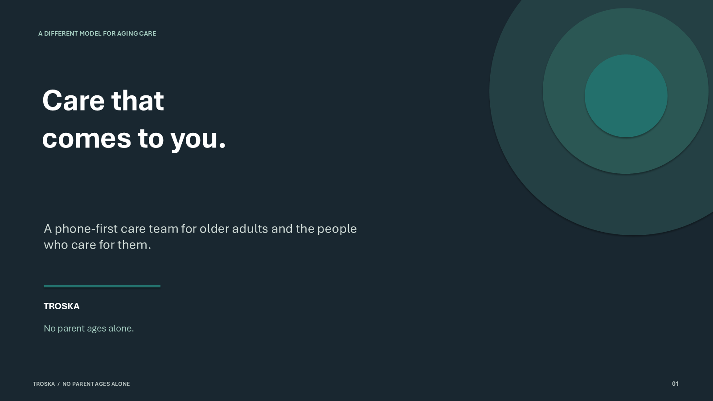
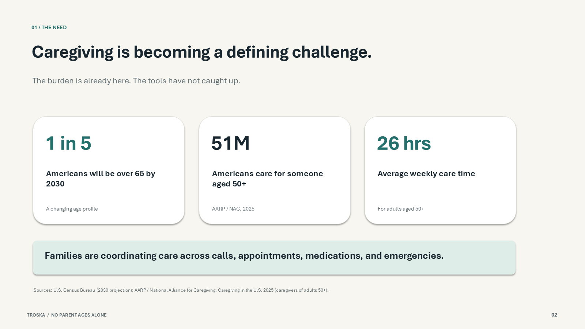
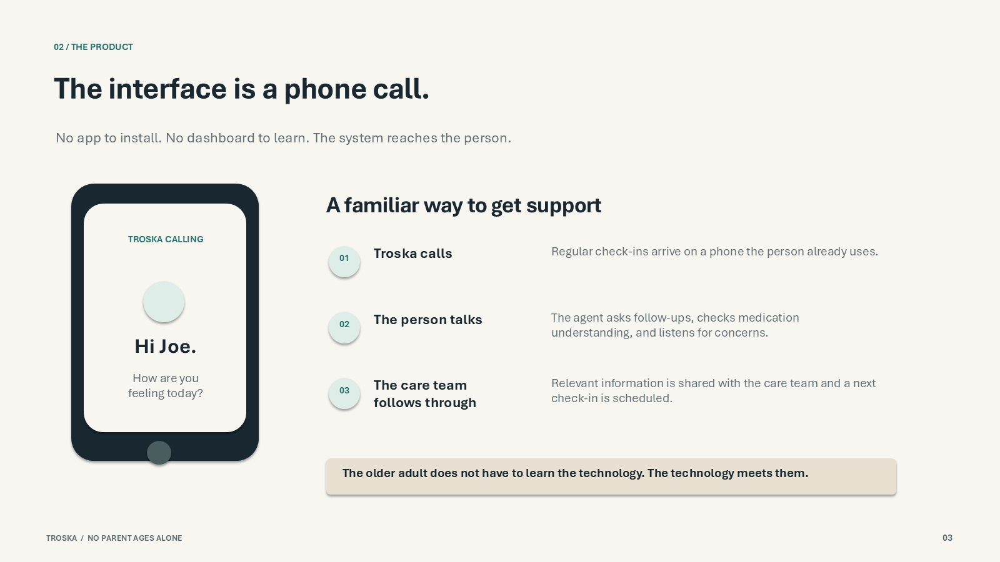
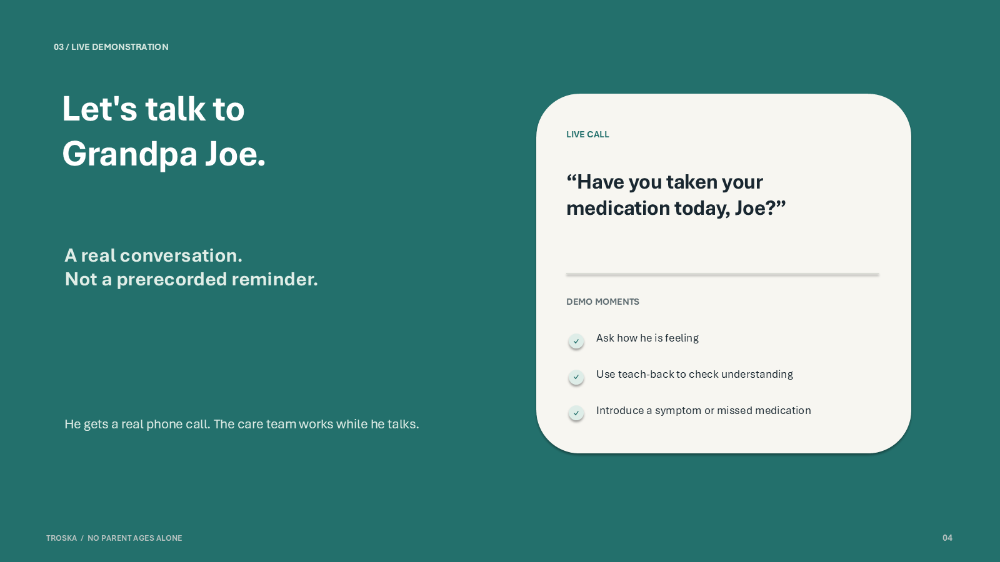
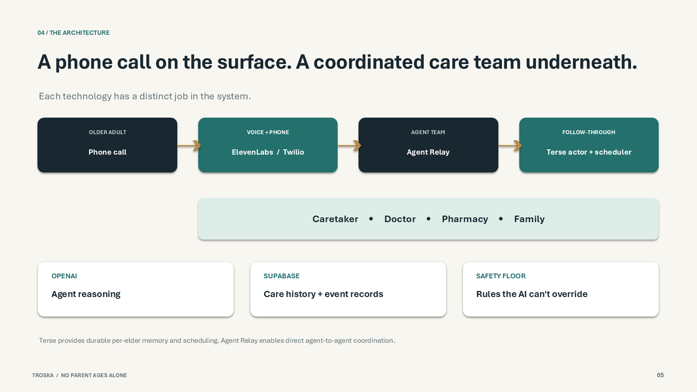
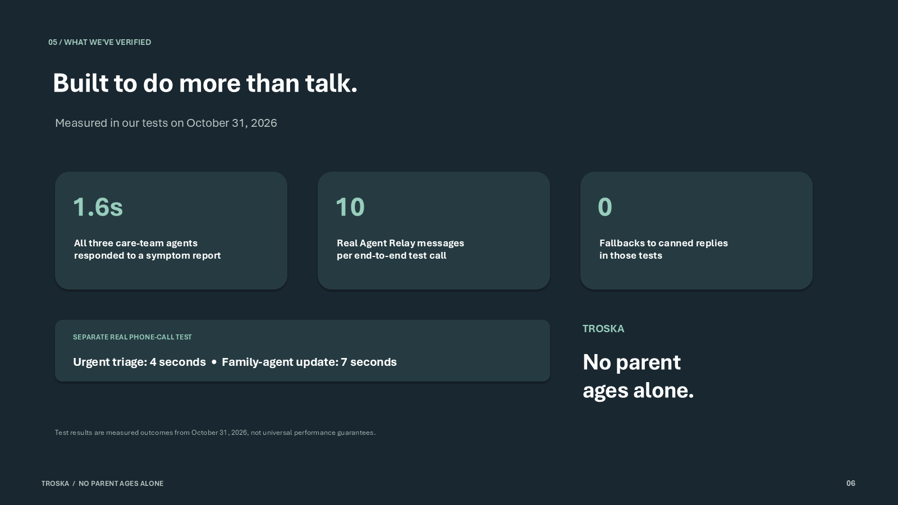
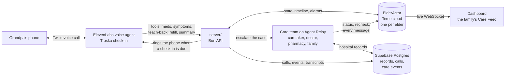
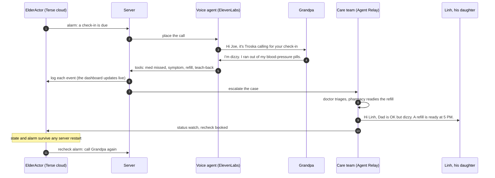
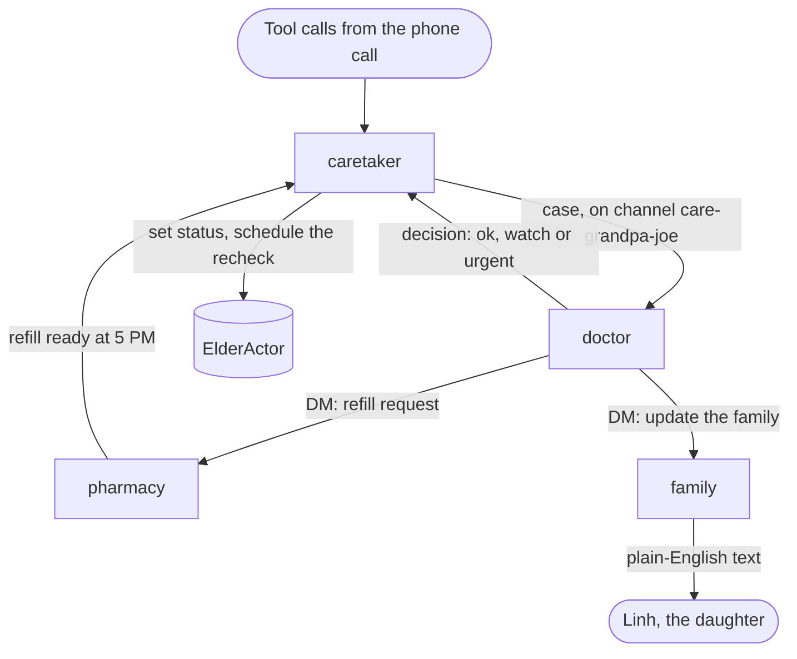

# Troska: an AI care team for aging parents

## 🩺 **A doctor is excited about Troska, and recommends it.**

**We asked a general physician (GP) about Troska. He was excited about the idea and recommended our app.**

### Market validation

- **A doctor wants it.** A general physician heard the idea, got excited about it and recommends Troska.
- **The need is big.** 51 million Americans care for someone aged 50 or older, about 26 hours a week (AARP / National Alliance for Caregiving, *Caregiving in the U.S.* 2025). By 2030, 1 in 5 Americans will be over 65 (U.S. Census Bureau).
- **YC asked for it.** "AI for the Aging Population" is on YC's Fall 2026 Request for Startups.

A voice agent makes check-in calls to an elder, on a real phone: it confirms medications, runs teach-back and notices when something is off.
Behind the call, doctor, pharmacy and family agents work the case with each other over Agent Relay, and one durable actor per elder remembers everything and schedules the next call.

Built at Haunted Hacks (Oct 31, 2026) with Terse Durable Actors, Agent Relay, ElevenLabs + Twilio (the phone call), OpenAI Realtime (the browser fallback) and Supabase. All people and medical data in this repo are fictional.

## Pitch deck

Six slides. Click a slide to see it full size, or [download the deck](docs/deck/Troska-Demo-Deck.pptx) (PowerPoint).

<p>
  <a href="docs/deck/slide-01.png"></a>
  <a href="docs/deck/slide-02.png"></a>
  <a href="docs/deck/slide-03.png"></a>
  <a href="docs/deck/slide-04.png"></a>
  <a href="docs/deck/slide-05.png"></a>
  <a href="docs/deck/slide-06.png"></a>
</p>

## Troska at a glance

**1. The whole system.** Grandpa talks on his own phone. Everything else happens behind the call.



**2. One check-in call, start to finish.** This is the 2-minute demo.



Grandpa can also call Troska on the same number, any time. The agent answers with his details: "Thanks for calling."

**3. The care team talks to itself on Agent Relay**, so the family doesn't have to play telephone. Each agent acts only on the messages Agent Relay delivers to it.



**Safety floor:** Troska never diagnoses. Chest pain, trouble breathing, fainting, a fall, slurred speech, or a heart rate of
130+ or 40 or below are always **urgent**, whatever the model says. Urgent means 911 advice, the human clinician paged,
the family told to go now, and a recheck call in 60 s.

## Sponsors and what we built with them

| Sponsor | What Troska uses it for | Prize track |
|---|---|---|
| **Terse** (Durable Actors) | One `ElderActor` per elder, deployed to Terse cloud: meds, status, timeline, and the alarm that places the next call. Restart anything else and nothing is lost. | Stateful Apps (iPhone Duo) |
| **Agent Relay** | Four agents (caretaker, doctor, pharmacy, family) coordinate on a real Agent Relay channel and DMs. Every message streams to the Care Feed. | Agent-to-agent (Mac mini) |
| **Terse + Agent Relay together** | The actor is the memory and the scheduler, and Relay is the coordination. Each does a job the other can't. | Bonus for using both |
| **Supabase** | Postgres is the system of record, with row-level security per family: hospital records, every call (with its transcript) and every care event. | Most likely to scale to millions |
| **OpenAI** | The agents' brains (`gpt-6-luna`), plus the browser voice fallback (`gpt-realtime-2.1`). | (credits) |

Also built with: ElevenLabs and Twilio (the phone voice, both directions), cloudflared (the webhook tunnel), Bun, and Vite + React.

## Prerequisites

- [Bun](https://bun.sh) 1.4.2 or newer
- The Terse CLI: `bunx terse-cli@latest install --yes` (installs to `~/.bun/bin/terse`)
- Chrome or another WebRTC browser with a microphone, for the live voice call
- An OpenAI API key (optional: without one, voice is offline, the agents use canned replies, and the scripted demo still runs)
- For the full product: the ElevenLabs API key (phone call), the Supabase URL and secret key (records and history), and a Terse API key (the cloud actor). All shared by DM, never in git.

## Where things run (live setup, Oct 31)

| Piece | Where | Config |
|---|---|---|
| `ElderActor` | **Terse cloud**, project `unc-actor` (org "unc"). Deployed with `cd actor && terse deploy` | `TERSE_ACTOR_URL=https://api.useterse.ai/cmvww8c4y013tjy2a0d2vx8x2/actors` and `TERSE_API_KEY` (app.useterse.ai → API keys) in `server/.env` and `care-team/.env`. With both set, no `terse actor dev` is needed, on any OS. |
| Hospital records, call archive, care history | **Supabase** (the team project). Schema + seed applied with `supabase/apply.ts` | `SUPABASE_URL` + `SUPABASE_SERVICE_ROLE_KEY` (the `sb_secret_` key) in `server/.env` and `care-team/.env` |
| Phone voice | **ElevenLabs** agent "Troska check-in" on our Twilio number "HH" | `server/.env`: see "3. The phone call" |
| Care team | **Agent Relay** (Relaycast), anonymous 24 h workspace per start | `RELAY_WORKSPACE_KEY` to keep one workspace |
| Agent brains, browser voice | **OpenAI** (`gpt-6-luna`, `gpt-realtime-2.1`) | `OPENAI_API_KEY` in `server/.env` and `care-team/.env` (or the root `.env` for dev.sh) |
| Web app | **Vercel**, project `troska`: https://troska.vercel.app. Only the static site is there; `/api` is proxied to the server on Mian's laptop through the cloudflared tunnel | `web/vercel.json` (the tunnel URL) and `DEMO_ACCESS_KEY` in `server/.env`. See "The hosted web app" below |

What Supabase holds, so the care history survives any restart or laptop: `patients`, `prescriptions` and `clinical_notes` (read by the demo reset and the doctor agent), `calls` (one row per call, with `started_at`, the summary, the mood and the ElevenLabs transcript), and `care_events` (every med, symptom, teach-back, refill and vitals event, every Agent Relay message, and every call ending).

## Quickstart

```sh
cp .env.example .env    # then set OPENAI_API_KEY in .env
./dev.sh                # starts actor :7100, server :8787, care-team :8788 and web :5173, prefixed logs, Ctrl-C stops all
```

Open http://localhost:5173/live (the demo dashboard; `/` is the landing page) when dev.sh prints the `[dev] ready` line. On a fresh clone, dev.sh runs `bun install` in `actor/` and `web/` first.

Check the whole system end to end (real actor, real OpenAI brains, real Agent Relay traffic) while dev.sh runs:

```sh
bun e2e.ts              # PASS/FAIL per step with latency per hop; exits 1 on any FAIL
```

## Testing, in order

Run these top to bottom before the demo. Steps 1 and 2 need no phone; step 3 rings a real one.

### 1. Unit tests (no keys, no network)

```sh
cd server    && bun install && bun test && bun run check   # tests + typecheck
cd care-team && bun test                                    # tests (no dependencies to install)
cd web       && bun install && bun test src && bun run build   # tests + production build
cd actor     && bun install && bun run check                # typecheck
```

Each line starts from the repo root. Every one should end with 0 fail or a clean exit. On the merge into `main` (Oct 31, 13:52): server 25, care-team 8, web 9 tests.

### 2. The whole stack, with the browser call

1. Install the Terse CLI once: `bunx terse-cli@latest install --yes`.
2. `cp .env.example .env` and set `OPENAI_API_KEY` (shared by DM, never in git).
3. `./dev.sh`, then wait for `[dev] ready`.
4. In a second terminal: `bun e2e.ts`. Every step should say PASS. Run it with `AUTO_DIAL` unset: e2e schedules a check-in, and with `AUTO_DIAL=1` that would ring the phone mid-test.
5. Open http://localhost:5173/live, open **Demo controls**, press **Reset demo**, then **Check-in in 15 s**, and answer in the browser. Say you're dizzy and ran out of your blood-pressure pills. The Care Feed should fill (doctor, pharmacy, family), the status should turn to watch, and a recheck should be scheduled.
6. Durability flex: see "The durability flex" under Troubleshooting.

**On Windows:** the Terse CLI has no Windows build of the local actor runtime ("No prebuilt runtime for win32/x64"), so use the cloud actor (table above) and skip `terse actor dev`. `dev.sh` is a bash script written for macOS (it uses `lsof` and process groups), so start the other three services in three terminals: `cd server && bun run start`, `cd care-team && bun run start`, `cd web && bun run dev`. Started that way, each service reads only its own folder's `.env`, so put `OPENAI_API_KEY`, the Terse and the Supabase settings in `server/.env` and `care-team/.env`. `terse deploy` on Windows needs Developer Mode on (it creates a symbolic link).

`bun e2e.ts` checks one care-team case per call: every agent message carries `data.caseId` (the call) and `data.trigger` (the escalation it answers: `symptom`, `refill`, `teach_back`, `summary`), and each medication is refilled once. Last run on the live setup (cloud actor, OpenAI, Agent Relay, Supabase): ALL PASS, every lane answered 4.1 s after the symptom.

### 3. The phone call (ElevenLabs + Twilio)

The ElevenLabs agent "Troska check-in" and our Twilio number ("HH") already exist in the team's ElevenLabs workspace. Whoever runs the demo machine does this setup once on that machine. Details: [server/README.md, Phone check-in](server/README.md#phone-check-in-elevenlabs--twilio).

1. Put these in **`server/.env`** (git-ignored). Bun loads it both under dev.sh and for `el:setup`.

   ```sh
   ELEVENLABS_API_KEY=xi-...          # elevenlabs.io → Settings → API keys
   ELEVENLABS_PHONE_NUMBER_ID=phnum_... # `elevenlabs agents phone-numbers list`, or the dashboard's Phone numbers page
   ELDER_PHONE=+1...                  # the phone that rings (the "Grandpa" teammate). Personal data: never commit it
   EL_TOOL_SECRET=...                 # any long random string
   AUTO_DIAL=1                        # ring the phone when the actor's alarm fires
   ```

2. Start a tunnel to the server, and copy the `https://…trycloudflare.com` URL it prints. Install cloudflared with `winget install --id Cloudflare.cloudflared` (Windows) or `brew install cloudflared` (Mac). The URL changes every time cloudflared restarts.

   ```sh
   cloudflared tunnel --url http://localhost:8787
   ```

3. Point the agent at this machine. This updates the agent's five webhook tools and the stored secret, and moves the HH number to "Troska check-in". It prints `ELEVENLABS_AGENT_ID`: add that to `server/.env`. Re-run it whenever the tunnel URL or `EL_TOOL_SECRET` changes.

   ```sh
   cd server && PUBLIC_URL=https://<tunnel> bun run el:setup
   ```

4. Restart `./dev.sh`, or just the server, so it reads the new `server/.env`.
5. Open http://localhost:5173/live, open **Demo controls**, press **Reset demo**, then **Check-in in 15 s**. When the countdown ends, the phone rings. Answer it as Grandpa: dizzy, out of the blood-pressure pill, and mix up the metformin timing on teach-back. The Care Feed fills while you talk. The timeline shows "Calling Joe's phone", then each med, symptom and teach-back event as it happens. After hang-up, the status turns to watch, and the recheck rings the phone again about 2 minutes later.
6. To ring the phone right away, without the countdown:

   ```sh
   curl -X POST localhost:8787/api/call/dial -H 'content-type: application/json' -d '{"elderId":"grandpa-joe"}'
   ```

7. **Grandpa can call Troska too.** Call our Twilio number from `ELDER_PHONE`, and the agent answers "Hi Joe, it's Troska. Thanks for calling." with his details. `el:setup` turns on the inbound webhook (`/api/el/init`). Without that webhook, ElevenLabs drops inbound calls immediately ("Missing required dynamic variables").
   **Every number is a person:**
   - Each caller is looked up by phone number in Supabase (`patients.phone`).
   - A number Troska hasn't met gets its own new profile. The agent asks "Who am I speaking with?" and saves their name, age, conditions and family contact (`save_profile`).
   - A known caller hears their own history: the last 3 calls and recent symptoms, read from Supabase.
   - Apply the phone column once with `bun supabase/apply.ts` (it runs every migration).
8. The post-call webhook is set up by `el:setup` too: it saves the secret in `server/.env`. After each call, a "Call recap" note lands on the timeline, the transcript goes to Supabase, and a call where Grandpa hangs up early is closed properly.
9. **A recap text after every call.** Without Twilio set up (the demo), the recap is written and shown on the timeline as "Text to Joe: ...", and nothing is sent. With Twilio, the person on the call gets it as a text from our Troska number: two warm sentences on what Troska heard, plus when it will call next. OpenAI rewrites the call summary for them; without a key, a plain template is used.
   - **Setup:** set `TWILIO_ACCOUNT_SID`, `TWILIO_AUTH_TOKEN` and `TWILIO_FROM` (our Twilio number) for the server.
   - **What the timeline shows:** "Texted Joe a recap of the call", or Twilio's reason if the text was refused.
   - **Carrier rules:** US carriers block texts from unregistered long-code numbers (Twilio error 30034, which needs A2P 10DLC registration), and a trial account can text only verified numbers.

**If the phone path breaks:**
- **No ring.** Run the `curl` dial above and read the error:
  - 503: a variable in `server/.env` is missing.
  - 502: ElevenLabs refused, and its message is included. A Twilio trial account can only call verified numbers.
  - 409: a call is already in progress. Press Reset demo.
- **It rings, but the Care Feed stays empty.** The tunnel is down, or its URL changed: re-run step 3. The server log shows 401 on `/api/el/tool/...` when `EL_TOOL_SECRET` doesn't match the one `el:setup` stored.
- **The call is stuck "in progress".** Press Reset demo, or set up the post-call webhook (step 7).
- **The fallback rule** (PLAN.md): if the phone path isn't solid, demo the browser call (step 2) and show the phone call in the backup video.

### 4. Right before judging

Press **Reset demo**, so no recheck alarm is left pending. Check that `curl localhost:8788/health` shows `"relay":"agent-relay"`. If you're demoing the phone, make sure the tunnel is still up, then ring it once with the `curl` above.

### The hosted web app (Vercel)

https://troska.vercel.app serves the web app from Vercel. The backend still runs locally: `web/vercel.json` rewrites `/api/*` to the cloudflared tunnel, and the tunnel reaches `server/` on port 8787. So the server and the tunnel must both be running.

- **Open it once with the team code.** Visit `https://troska.vercel.app/live?key=<DEMO_ACCESS_KEY from server/.env>`. The browser remembers the code. Without it, the server answers 403 and the page shows "Offline".
- **When the tunnel URL changes** (every time cloudflared restarts), put the new URL in `web/vercel.json`, then redeploy:

```bash
cd web && vercel deploy --prod
```

`vercel deploy` uploads `web/`, and Vercel builds it there with the `build` script. The project is already linked; the CLI keeps that link in `web/.vercel/`, which git ignores. The project is deliberately not connected to GitHub. A deploy from a push would use the `web/vercel.json` in git, which may still hold an old tunnel URL, so deploys only come from the CLI.

### Keeping the backend up (Windows)

[scripts/keep-alive.ps1](scripts/keep-alive.ps1) is a watchdog for the laptop that runs the backend. Every 30 seconds it checks the server (:8787), the care team (:8788) and the tunnel, and restarts whichever is down. If the tunnel has to restart, it gets a new URL, so the watchdog also re-points everything at it:
1. It re-points the ElevenLabs webhooks with `bun run el:setup`.
2. It writes the new URL into `web/vercel.json` and runs `vercel deploy --prod`.
3. It restarts the server, so it loads the new webhook secret.

Only then does it stop the old tunnel. To switch tunnels on purpose, create the file `%LOCALAPPDATA%\Troska\rotate-tunnel`. Logs go to `%LOCALAPPDATA%\Troska\`. The keys come from your Windows user environment, as above.

To start it at every logon, run this once. It installs the "Troska keep-alive" scheduled task for your user (no admin needed) and starts it:

```bash
powershell -ExecutionPolicy Bypass -File scripts/install-keep-alive.ps1
```

Add `-Remove` to take the task out again. Only one watchdog runs at a time: a second copy waits and takes over when the first one exits. The laptop still has to stay awake and online. After it wakes, the watchdog brings back anything that stopped.

## Demo flow

The 2-minute script is in [PLAN.md, Demo](PLAN.md#demo-the-centerpiece-one-person-talks-the-screen-shows-the-context-live). In short: Reset demo, Check-in in 15 s, Grandpa's phone rings (or he answers in the browser, the fallback), Grandpa says he is dizzy and out of his blood-pressure pills, the Care Feed fills with the doctor, pharmacy and family agents' messages, his status turns to watch with a recheck scheduled, then restart our server and show that the state and the pending recheck survive, because they live in the actor in Terse cloud.

## Architecture

The diagrams in [Troska at a glance](#troska-at-a-glance) show how the pieces connect. Ports:
- `web/` on :5173
- `server/` on :8787. ElevenLabs reaches it through a tunnel at `/api/el/*`.
- `care-team/` on :8788
- `actor/` in Terse cloud, or `terse actor dev` on :7100

The browser fallback for the call is OpenAI Realtime over WebRTC, which posts its tool calls to `POST /api/tool`.

| Folder | What it is |
|---|---|
| [actor/](actor/README.md) | `ElderActor`, the Terse durable actor: state, timeline, alarm-scheduled check-ins, live WebSocket fan-out |
| [server/](server/README.md) | Bun HTTP API: the ElevenLabs phone call (dial, webhook tools, auto-dial), Realtime voice keys, the voice agent's tools, demo endpoints, Supabase call archive |
| [care-team/](care-team/README.md) | The caretaker, doctor, pharmacy and family agents on Agent Relay |
| [web/](web/README.md) | The demo screen: the call panel and the live Care Feed |
| [supabase/](supabase/README.md) | Postgres schema with RLS, fictional seed records |

The shared contract between the folders is [PLAN.md](PLAN.md).

## Troubleshooting

- **A port is busy.** dev.sh stops if 7100, 8787, 8788 or 5173 is taken. Find the process with `lsof -iTCP:8787 -sTCP:LISTEN`. Web must stay on 5173, because the server only allows CORS from there.
- **Voice fails or there is no key.** The call panel shows "Voice offline". Use **Run scripted demo**: it plays the same storyline with real tool calls, so the actor and the care team still react for real (labeled "scripted"). `http://localhost:5173/live?mock=1` renders a fixture with no server at all. Add `?debug` to the URL to log every Realtime event in the browser console.
- **Agent Relay.** With no `RELAY_WORKSPACE_KEY`, each care-team start creates a fresh anonymous 24-hour workspace, so the relay history starts empty after a restart (the actor timeline keeps it). Set `RELAY_WORKSPACE_KEY` to keep one workspace (see [care-team/README.md](care-team/README.md)). `RELAY_MODE=local` is an offline fallback that does not use Agent Relay. `curl localhost:8788/health` shows the relay mode, the model and how many OpenAI calls fell back to canned replies.
- **The durability flex.** With the Terse cloud actor (the live setup): stop the server with Ctrl-C and start it again. Our server keeps no state, so the dashboard reconnects with Grandpa's state, timeline and pending recheck intact, and with `AUTO_DIAL=1` the recheck still rings his phone once the server is back. With dev.sh and a local actor: stop only the actor with `pkill -INT -f "terse actor dev"` (server, care-team and web keep running), then start it again in a second terminal: `cd actor && ~/.bun/bin/terse actor dev`. The dashboard reconnects with a fresh grant, and the state and a pending check-in alarm survive. The local runtime re-arms the alarm when something wakes the actor (see [actor/README.md](actor/README.md)). An actor started that way is outside dev.sh, so stop it with Ctrl-C in its own terminal.
- **Slow or odd agent messages.** Defaults are `OPENAI_MODEL=gpt-6-luna` and `OPENAI_REASONING_EFFORT=none`. `bun e2e.ts` prints the latency of every hop.
